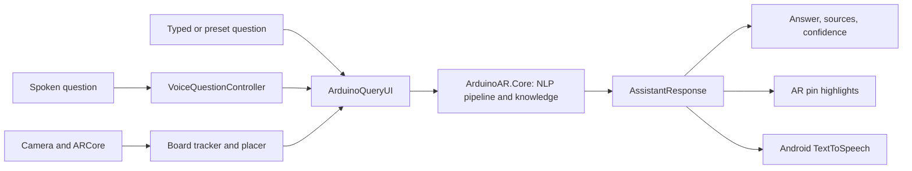

# NLP-Based Conversational Augmented Reality Tutor for Interactive Engineering Education

An Android application that lets a learner ask questions about a development board by typing, tapping a preset or speaking. It answers with its sources and uncertainty, highlights the relevant pins in augmented reality (AR), and can read the answer aloud.

**Demo video:** [Watch the demonstration](https://drive.google.com/file/d/1-6FXcjGhS8zfVCtqBspkHDsgRPwn1x0g/view?usp=drive_link)

Developed by Mallika Mathur for CSI4001 Natural Language Processing and Computational Linguistics, Fall Semester 2026-27.

## Objectives

- Answer pin, concept, board and wiring questions for two boards through one pipeline.
- Provide wiring guidance and contextual follow-ups for four beginner circuits.
- Deliver answers as text, AR highlights and speech on a real Android phone.
- Label every inferred SPDUINO pin function as unverified.

## Key features

### Physical SPDUINO mode

- Recognises a real SPDUINO board with ARCore image tracking, using one 65 x 50 mm reference image.
- Reports Searching, Recognized and TrackingLost states, and holds a question until the board is tracked.
- Draws a board outline and pin markers from the board profile, and answers from that profile.

Better recognition of the physical board was the main improvement in this milestone. Tracking is still not fully stable, and markers are not pin-exact (see [Known limitations](#known-limitations)).

### Virtual Arduino Uno mode

- Places a code-built Uno model on a detected horizontal surface, or about 45 cm in front of the camera.
- Needs no physical board.
- Colours the pins on the model by wiring role.

### Conversational NLP

The conversational system is rule-based. It does not use an LLM, RAG, an embedding model or a trained language model.

- Handles pin lookups, capability checks, concept explanations, pin lists, board facts and board comparisons.
- Resolves follow-up questions from the previous topic, pins and active circuit.
- Shows sources, a confidence value, uncertainty notes and safety caveats with answers. Confidence is a hand-set rule value, not a probability.

### Circuit guidance

| Circuit | Default pin | Resistor follow-up explains |
|---|---|---|
| LED | D9 | Current limiting |
| Push button | D2 | Internal pull-up |
| Potentiometer | A0 | Not applicable (follow-ups cover the wiper, outer legs and readings) |
| LDR | A0 | Voltage divider |

- Includes 16 follow-up patterns, and wiring guidance for I2C modules.
- Uses a pin the learner names only if the board profile allows that function.
- Corrects unsafe requests, such as connecting an LED without a resistor.

This is wiring guidance only. **The circuits have not been physically built and tested.**

### Board knowledge

| | Arduino Uno R3 | SPDUINO |
|---|---|---|
| Pins | 31 | 28 |
| Board facts | 9 | 10 |
| I2C | SDA/SCL headers and A4/A5 | A4/A5, unverified |

The knowledge base also holds 13 general concept facts. Every fact carries a status: verified on board, documented, inferred or general. Twelve SPDUINO pins have inferred functions (D2, D3, D10-D13 and A0-A5), and answers mark these as UNVERIFIED.

### Speech

- Speech input uses Android SpeechRecognizer with the device's default language and engine. It requests up to three alternatives and picks the first one the classifier understands.
- Speech output uses Android TextToSpeech. It reads the answer text only, up to 600 characters.
- English is the supported language.

## Architecture and workflow



One response drives the displayed text, the AR highlights and the speech. The core assembly can be tested without a phone.

### NLP pipeline

| Stage | What it does |
|---|---|
| 1. Normalise | Lower-cases text and unifies spoken forms, so "i squared c" becomes `i2c` and "pin five" becomes `pin 5` |
| 2. Extract entities | Finds pins, boards, components, technical terms, and comparison, connection and follow-up cues |
| 3. Classify intent | Uses 13 weighted keyword topics and 9 query kinds |
| 4. Resolve context | Uses the previous topic, relevant pins and active circuit |
| 5. Retrieve facts | Applies structured fact filters first, with BM25-style lexical search as a fallback (k1 = 1.2, b = 0.75, threshold = 2.0) |
| 6. Generate answer | Fills fixed templates with sources, confidence, uncertainty and caveats |

## Technology stack

| Component | Version |
|---|---|
| Unity | 6000.6.4f1 |
| AR Foundation | 6.6.2 |
| ARCore XR Plugin | 6.6.2 |
| Universal Render Pipeline | 17.6.0 |
| Input System | 1.20.0 |
| uGUI | 2.6.0 |
| XR Management | 4.7.0 |
| Unity Test Framework | 1.8.0 |
| Language | C# |
| Android target | Minimum API level 26, IL2CPP, ARM64 |

## Setup and build

The commands below were run on the development machine and **have not been tested on a fresh machine**.

**Requirements**

- Unity 6000.6.4f1 with Android Build Support.
- An ARCore-supported Android phone at API level 26 or later, with Google Play Services for AR.
- Optional: the Unity command-line tool (`unity`), for the test and build commands. They were run with version 1.0.0-beta.13, a beta release, so options may differ in other versions.

**Open the project**

```bash
git clone https://github.com/m1mallika1/Conversational-AR-Tutor.git
```

Add the cloned folder to Unity Hub and open it with Unity 6000.6.4f1. Unity restores the packages from `Packages/manifest.json`.

**Run the tests**

In the Unity Editor, open **Window > General > Test Runner**, select **EditMode** and choose **Run All**. Or, from the project folder with the Unity command-line tool:

```bash
unity test . --mode EditMode --output Logs/tests.xml --non-interactive
```

**Build the APK**

In the Unity Editor, open **File > Build Profiles**, select the **Android** profile and choose **Build**. Or, with the Unity command-line tool:

```bash
unity build . --profile "Assets/Settings/Build Profiles/Android™.asset" --android-export-type apk -o Builds/Android/AI_Conversational_AR.apk -l Logs/build.log --no-tail --non-interactive
```

**Install and launch** (USB debugging enabled, with the Android SDK's `adb` tool)

```bash
adb install -r Builds/Android/AI_Conversational_AR.apk
```

```bash
adb shell am start -W -n com.UnityTechnologies.com.unity.template.urpblank/com.unity3d.player.UnityPlayerGameActivity
```

The APK is not included in this repository, and the application has not been publicly released.

## Using the app

1. Allow camera access. Microphone permission is requested the first time you tap **Mic**.
2. **Physical board:** the app starts in this mode. Hold the phone steadily above the SPDUINO in good light until the status line says "Recognized".
3. **Virtual Uno:** tap **Switch to Virtual Uno**, move the phone slowly over a textured surface, then tap the detected surface or tap **Place here**.
4. Ask a question using a preset, the text box and **Ask**, or **Mic**.

## Testing and results

The evaluation questions are self-written. No external benchmark was used, no classical or transformer baseline was run, and no learner study was conducted. Automated test and after-fix results are for the final commit, `562ca28`. First-run and earlier-code scores were recorded earlier in development.

### Automated tests

**278 passed, 0 failed, 0 skipped**, in Unity EditMode with fake speech backends. These tests do not exercise the camera, the ARCore runtime or a real microphone.

| Test class | Tests |
|---|---:|
| NlpFeature | 68 |
| BoardAssistant | 65 |
| SpeechHandling | 65 |
| CircuitGuide | 45 |
| VoiceInteraction | 29 |
| AlignmentGeometry | 4 |
| NlpEvaluation (v1 report) | 1 |
| NlpEvaluationV2 (v2 report) | 1 |

### Evaluation sets

| Set | Earlier code | First run | After later fixes |
|---|---:|---:|---:|
| Held-out general (30 questions) | 16/30 | **24/30 (80.0%)** | 30/30 |
| Held-out circuits (24 questions) | 5/24 | **22/24 (91.7%)** | 23/24 |
| Development regression v1 (112 turns) | Not used | 111/112 | 112/112 |
| Development regression v2 (44 turns) | Not used | 44/44 | 44/44 |

- **First-run held-out scores are the primary results.**
- After-fix scores are not independent, because the fixes were made after inspecting those same questions.
- v1 and v2 were used during development, so they act as regression checks.
- The two held-out sets are scored differently: general on intent only, circuits on intent, highlights and answer text.
- The earlier-code scores show this project's own progress and are not an external baseline.
- The v1 and v2 sets are in `Assets/Tests/EditMode`. The held-out question sets are not in this repository.

### Real-device observations

Tested on one REDMI Note 15 5G (Android 16, API 36, ARCore 1.57) with one physical SPDUINO board. "Final build" means the APK built from commit `562ca28`.

- **Final build, physical board:** the log recorded 18 Recognized and 18 TrackingLost events across two app runs. These counts are not a tracking-rate measure, because the camera was not kept on the board under controlled conditions.
- **Separate session on commit `6fea19c`:** about 78% tracking time over 115.6 s, nine losses, a median recovery of 0.57 s, and longer recoveries of 7.5 s and 14.7 s.
- **Final build, virtual Uno:** the model was placed in AR, and PWM, LED and potentiometer answers highlighted the expected pins.
- **Final build, voice:** eight spoken questions were recognised. Text-to-speech reported ready, but audible output was not confirmed from logs.

## Known limitations

- **NLP coverage:** rules miss some question wording and some spelling errors.
- **Input handling:** symbols-only input can repeat the previous answer, and an out-of-range pin number in a wiring request can be ignored.
- **Language:** Hindi falls back safely, and Hinglish works only when a keyword matches.
- **Physical tracking:** tracking is not fully stable. The reference image scores 65/100 in ARCore, below the recommended 75.
- **Marker alignment:** markers are not pin-exact, with about 4-10 mm of offset seen in one frame.
- **Speech recognition:** it depends on the device's service. In one test, "wiper" was heard as "viper", and the app gave the wrong answer.
- **Stability:** one native crash (SIGSEGV) was logged on the final build, on thread `MTC_feature_ext`. In its backtrace, frames 0-7 are in `libarcore_c.so` from the ARCore app and frames 8-9 are in Android's `libc`. The cause is unknown and it has not been reproduced.
- **Board ratings:** the system declines current and voltage rating questions, but the Uno 3.3V and VIN answers state "max ~50 mA" and "7-12 V".
- **Unverified pins:** inferred SPDUINO pin functions remain unconfirmed.
- **Circuit guidance:** no guided circuit has been physically built and tested. Confirm wiring against official documentation before powering a circuit.
- **Evaluation scope:** the questions are self-written and few, and testing covered one phone and one board. No external benchmark or learner study was conducted, so no claim is made about learning outcomes.
- **Release:** the application has not been publicly released.

## Possible future work

These items are not implemented: physical circuit validation, better tracking and marker alignment, improved speech recognition, more boards and knowledge, an optional LLM, and learner studies.

## Repository layout

| Path | Contents |
|---|---|
| `Assets/Scripts/ArduinoAR` | AR, interface and voice components |
| `Assets/Scripts/ArduinoAR/Core` | Core assembly: board profiles, NLP pipeline, knowledge base and voice logic |
| `Assets/Tests/EditMode` | Automated tests and the v1 and v2 evaluation sets |
| `Assets/ReferenceImages` | SPDUINO reference image and image library |
| `WorkInProgress/SPDUINO_Rectification` | Reference-image correction files and measurements |

## Sources and acknowledgements

- The SPDUINO reference image comes from the author's own photograph of the physical board.
- SPDUINO details also draw on the [manufacturer's product page](https://sproboticworks.com/shop/products/spduino-arduino-compatible--board-.html).
- Claude Code, an AI coding assistant from Anthropic, was used during implementation, testing and documentation.
